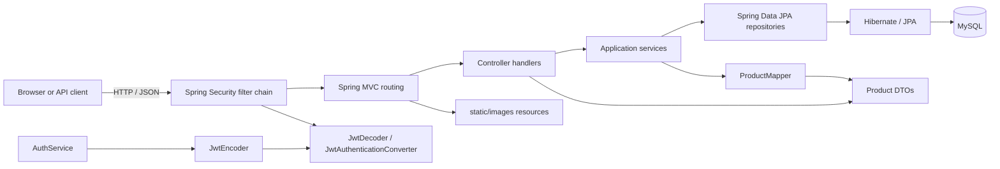

# Complete Application Architecture and Execution Flow

This document describes the current project snapshot. The application-level calls below are deterministic from source; Spring's internal bean-creation sequence is framework-managed and should not be read as a guaranteed total ordering. For file purpose, algorithms, design reasons and trade-offs, see [design.md](design.md).

## 1. System context

The project is a Java 21 / Spring Boot Maven REST API backed by MySQL through JPA/Hibernate. A browser frontend is expected to call its HTTP endpoints; CORS currently permits `http://localhost:5173`. Images in Spring Boot's static-resource directory are served by the API. No frontend source code is present in this Maven project.

## 2. Process entry and application startup

### Entry point

`src/main/java/com/ShopNow/myShopping/MyShoppingApplication.java`

1. The JVM calls `MyShoppingApplication.main(String[] args)`.
2. `main` calls `SpringApplication.run(MyShoppingApplication.class, args)`.
3. Spring Boot applies auto-configuration and scans `com.ShopNow.myShopping` for annotated components and configuration.
4. Spring reads `src/main/resources/application.properties`, including the optional `.env` properties import. `DB_USERNAME`, `DB_PASSWORD`, and `JWT_SECRET` must resolve from configuration/environment for the dependent beans to initialize.
5. Spring configures the HTTP server/MVC, Security, JPA repositories, Hibernate and MySQL datasource, then makes the service available if startup succeeds.

Spring may create/configure independent beans in different internal orders. The guaranteed application sequence is the entry call into Spring, configuration and context startup before HTTP request handling—not a precise ordering among every bean constructor.

### Build/test support path

`pom.xml` defines Java/dependency/plugin configuration. `mvnw` and `mvnw.cmd` start Maven using `.mvn/wrapper/maven-wrapper.properties`. Maven compiles `src/main/java`, copies resources, compiles tests and runs the selected test lifecycle. `MyShoppingApplicationTests.contextLoads()` asks Spring to start the context and fails if startup wiring/configuration is broken; it has no endpoint assertions.

## 3. Common HTTP request order

For a normal API request:

1. The embedded server accepts HTTP.
2. `SecurityConfig.securityFilterChain(HttpSecurity)`'s filters apply CORS, authentication and authorization before the handler. For a bearer token, Spring's resource-server support calls the configured decoder; invalid/expired tokens are rejected before controller execution.
3. Spring MVC selects a controller/method from route annotations and binds request body, path variables and authentication context.
4. `@Valid` validates only handlers/parameters where explicitly present (currently register and login requests).
5. The controller calls its service (or, in a few flows, performs a repository lookup directly).
6. Service logic may call other services, repositories, mappers, password/JWT infrastructure, and entity methods.
7. Spring Data repository proxies execute derived queries/CRUD through JPA/Hibernate and the MySQL datasource.
8. Return values travel back up through service/controller; Spring serializes DTOs/entities/records as JSON. Static resources are served by Spring MVC's static-resource handler instead of controller/service/repository logic.

### Security gate

Configured public routes:

- `GET /product`, `GET /product/**`
- `GET /category`, `GET /category/**`
- `GET /images/**`
- `POST /auth/register`
- `POST /auth/login`

All remaining paths require authentication. `POST`, `PUT`, `PATCH`, and `DELETE` on `/product/**` and `/category/**` additionally require role `USER_ADMIN`. The JWT converter reads claim `role` and adds prefix `ROLE_`, which is the authority convention expected by `.hasRole("USER_ADMIN")`. Other authenticated feature routes include `/auth/me`, `/cart/**`, and `/wishlist/**`.

CSRF is disabled and sessions are stateless in the current filter chain. CORS settings are in `Config/CorsConfig.java`; CORS is not authentication and does not replace the authorization rules.

## 4. Endpoint-to-function call chains

### Authentication and current-user lookup

#### `POST /auth/register`

`AuthController.register(RegisterRequest)`
→ Jakarta validation on `RegisterRequest`
→ `AuthService.register(request)`
→ `AppUserRepo.existsByEmail(email)`
→ if already registered, throw `IllegalArgumentException`
→ create `AppUser`, copy name/email, call `PasswordEncoder.encode(password)`
→ set role `USER_CUSTOMER` and active true
→ `AppUserRepo.save(user)`
→ construct `RegisterResponse(id,name,email,role)`
→ controller responds `201 Created`.

#### `POST /auth/login`

`AuthController.login(LoginRequest)`
→ validation of email/password
→ `AuthService.login(request)`
→ build `UsernamePasswordAuthenticationToken(email,password)`
→ `AuthenticationManager.authenticate(...)`
→ Spring Security invokes `CustomUserDetailsService.loadUserByUsername(email)` through its configured authentication provider
→ `AppUserRepo.findByEmail(email)` creates Spring `UserDetails` with stored hash, role and disabled status
→ provider verifies password via configured `PasswordEncoder`
→ on success `AuthService` calls `AppUserRepo.findByEmail(email)` to load application user data
→ construct time/issuer/email subject/name/role/issued/expiry JWT claims
→ `JwtEncoder.encode(JwtEncoderParameters.from(header,claims))`
→ `JwtConfig`-provided Nimbus encoder signs HS256 using the decoded shared secret
→ construct `LoginResponse`
→ controller responds `200 OK`.

Failed authentication exits through Spring Security before a successful response is built. The application uses the same shared key for token issuance and verification.

#### `GET /auth/me`

HTTP bearer token
→ security resource-server filter calls `JwtDecoder` (Nimbus HS256) and validates signature/time claims
→ `SecurityConfig.jwtAuthenticationConverter()` maps `role` to `ROLE_<role>` authorities
→ `AuthController.currentUser(@AuthenticationPrincipal Jwt)`
→ return map `{email: jwt.subject, name: jwt.claim("name")}`.

### Products — `ProductController` → `ProductService` → `productRepo`

- `GET /product`: `ProductController.getAllProducts` → `ProductService.getAllProducts` → `repository.findAll()` → stream each `Product` through `ProductMapper.toResponse` → return `List<ProductResponseDTO>`.
- `GET /product/{id}`: `getProduct(id)` → `ProductService.getProduct(id)` → `repository.findById(id)` → `ProductMapper.toResponse` → response DTO. Missing ID currently throws a generic runtime exception.
- `POST /product`: `addProduct(request)` → `ProductService.save` → `ProductMapper.toEntity` (sets fields; defaults omitted `active` to false) → repository save → `toResponse` → response DTO.
- `PUT /product/{id}`: `updateProduct` → `ProductService.update` → find existing product → `ProductMapper.updateEntity` replaces editable fields → save → `toResponse`.
- `PATCH /product/{id}`: `patchProduct` → `ProductService.patch` → find existing product → `ProductMapper.patchEntity` copies only non-null input fields → save → `toResponse`. As implemented, a field cannot be explicitly set to null.
- `DELETE /product/{id}`: `deleteProduct` → `ProductService.remove` → `existsById` → `deleteById`; absent item throws a generic runtime exception.

`ProductRequestDTO`, `ProductPatchRequestDTO`, and `ProductResponseDTO` define transport shapes; `ProductMapper` is the field-by-field conversion boundary. `Product` is the persisted entity. `productRepo` inherits basic CRUD from `JpaRepository` and declares no custom queries.

### Categories — `CategoryController` → `CategoryService` → `CategoryRepo`

- `GET /category`: controller `getAllCategories` → service `getAllCategories` → `CategoryRepo.findAll` → list of `Category` entities.
- `POST /category`: `addCategory` → service `addCategory` → repository `save`.
- `PUT /category/{id}`: `updateCategory(id,body)` → service looks up ID → replaces name/imageUrl/active → saves.
- `PATCH /category/{id}`: `patchCategory(id,Map)` → service looks up ID → checks which keys are present and verifies values (`name` nonblank string, `imageUrl` string, `active` boolean) → changes only those fields → saves.
- `DELETE /category/{id}`: `deleteCategory` → service lookup → repository delete → controller returns success text.

Unlike product handlers, category handlers bind/return `Category` entities directly. `CategoryRepo` adds no custom query methods.

### Cart summary — `GET /cart`

`CartController.getCart(Authentication)`
→ `Authentication.getName()` (JWT subject/email)
→ controller calls `AppUserRepo.findByEmail`
→ if no user, 401 `ResponseStatusException`
→ `CartService.getCartDetails(user)`
→ `CartRepo.findByUser(user)` (if no cart, 404; does not create one here)
→ `CartItemRepo.findByCartId(cart.id)`
→ for each `CartItem`, multiply `unitPrice * quantity` with `BigDecimal` and build `CartItemResponseDTO`
→ sum quantities as `int`; reduce subtotals from `BigDecimal.ZERO`
→ construct `CartResponseDTO(cartId,items,totalItems,totalAmount)`.

### Cart items — `/cart/items`

`CartIemController.getAuthenticatedUser(Authentication)` is called by each handler. It rejects null authentication; looks up `AppUser` by authentication name; missing user yields 401.

- `GET /cart/items`: controller → `CartItemService.getItems(user)` → private `getUserCart` → `CartService.getOrCreateCart(user)` → `CartRepo.findByUser`, or create/save `Cart` → `CartItemRepo.findByCartId` → stream through private `toDTO` → list of `CartItemResponseDTO`.
- `POST /cart/items`: controller's `AddCartItemRequest(productId,quantity)` → `CartItemService.addItem` → require quantity > 0 → get/create cart → private `getAvailableProduct(productId)` queries `productRepo.findById`, requires active and stock > 0 → `CartItemRepo.findByCartAndProduct` → if found, add requested quantity; otherwise create `CartItem` and attach cart/product → reject quantity greater than stock → set quantity and current product price → save → `toDTO` calculates subtotal and returns DTO. Controller responds `201 Created`.
- `PATCH /cart/items/{itemId}`: controller's `UpdateCartItemRequest(quantity)` → service validates positive quantity → get/create cart → `CartItemRepo.findByIdAndCartId(itemId,cart.id)` ensures the item belongs to this user's cart → `getAvailableProduct` rechecks active/stock → reject above-stock quantity → set new quantity/current price → save → `toDTO`.
- `DELETE /cart/items/{itemId}`: controller → service obtains cart → `findByIdAndCartId` ownership-scoped lookup → repository deletes row. Controller responds `204 No Content`.

`CartItemRepo` derived methods implement lookup by cart ID, cart+product, and item ID+cart ID. `CartRepo.findByUser` implements user-cart lookup. DB uniqueness constraints backstop duplicate cart/product rows.

### Wishlist — `/wishlist`

Each controller handler first calls private `getCurrentUser(Authentication)` → `authentication.getName()` → `AppUserRepo.findByEmail`; missing account returns 401. Add/remove then call `productRepo.findById(productId)`; missing product returns 404.

- `GET /wishlist`: controller → `WishlistService.getWishlist(user)` → `WishlistRepo.findByUser(user)` → list of `Wishlist` entities.
- `POST /wishlist/{productId}`: controller loads product → `WishlistService.addToWishlist(user,product)` → `WishlistRepo.findByUserAndProduct` → return existing row or create/set user+product/save new entity.
- `DELETE /wishlist/{productId}`: controller loads product → `WishlistService.removeFromWishlist` → lookup pair → throw if not present → delete row.

`WishlistRepo` derived queries and the unique `(user_id,product_id)` constraint support the find-or-create policy.

### Static images

Files beneath `src/main/resources/static/` are exposed through Spring Boot's static-resource handling; they do not pass through a domain controller, service, or repository. In particular, `static/images/Hero/hero.jpg`, `static/images/Categories/*`, and `static/images/products/*` correspond to paths permitted by `/images/**`. Database image URL strings can point clients to these assets.

## 5. File interaction map (all application Java files)

| File | Calls/uses | Called by / participates in |
|---|---|---|
| `MyShoppingApplication.java` | Calls Spring Boot `SpringApplication.run`. | Process/JVM invokes `main`; Spring scans remaining app components. |
| `Config/SecurityConfig.java` | Builds filter chain, password encoder, auth manager, JWT authority converter. | Spring initializes configuration; filters wrap every HTTP request; `AuthService` receives encoder/auth manager. |
| `Config/JwtConfig.java` | Creates secret key, `JwtEncoder`, `JwtDecoder`. | `AuthService` uses encoder; Spring resource server uses decoder; key comes from properties. |
| `Config/CorsConfig.java` | Registers allowed origin/method policy. | Spring MVC/Security CORS handling. |
| `Controller/AuthController.java` | Calls `AuthService`; reads principal JWT for `/me`. | Spring MVC maps `/auth/**`; Security protects `/me`. |
| `Controller/ProductController.java` | Calls `ProductService`. | Spring MVC maps `/product/**`; Security allows reads, admin-only writes. |
| `Controller/CategoryController.java` | Calls `CategoryService`. | Spring MVC maps `/category/**`; Security allows reads, admin-only writes. |
| `Controller/Cart/CartController.java` | Calls `AppUserRepo`, then `CartService`. | Spring MVC maps `GET /cart`; security requires JWT. |
| `Controller/Cart/CartIemController.java` | Resolves user via `AppUserRepo`; calls `CartItemService`. | Spring MVC maps `/cart/items/**`; security requires JWT. |
| `Controller/Wishlist/WishlistController.java` | Resolves user/product via `AppUserRepo`/`productRepo`; calls `WishlistService`. | Spring MVC maps `/wishlist/**`; security requires JWT. |
| `Service/AuthService.java` | Calls `AppUserRepo`, `PasswordEncoder`, `AuthenticationManager`, `JwtEncoder`; builds auth DTOs. | `AuthController`; authentication manager uses `CustomUserDetailsService`. |
| `Service/CustomUserDetailsService.java` | Calls `AppUserRepo.findByEmail`; adapts user to Spring `UserDetails`. | Called by Spring Security username/password provider during login. |
| `Service/ProductService.java` | Calls `productRepo` and `ProductMapper`; uses Product entity and product DTOs. | `ProductController`. |
| `Service/CategoryService.java` | Calls `CategoryRepo`; works on `Category`. | `CategoryController`. |
| `Service/Cart/CartService.java` | Calls `CartRepo`, `CartItemRepo`; creates cart or summary DTOs. | `CartController` and `CartItemService`. |
| `Service/Cart/CartItemService.java` | Calls `CartService`, `CartItemRepo`, `productRepo`; builds item DTO. | `CartIemController`. |
| `Service/WishList/WishlistService.java` | Calls `WishlistRepo`; reads/writes `Wishlist` for user/product. | `WishlistController`. |
| `Mapper/ProductMapper.java` | Copies fields between product DTOs and `Product`. | `ProductService`. |
| `Entity/AppUser.java` | JPA account row, including enum role and password hash. | Auth/user repository, cart and wishlist relationships. |
| `Entity/Role.java` | Allowed role enum values. | `AppUser`, registration, security claim values. |
| `Entity/Product.java` | JPA product row. | Product service/repository, cart items, wishlist, product mapper. |
| `Entity/Category.java` | JPA category row. | Category controller/service/repository. |
| `Entity/Cart/Cart.java` | JPA user cart. | Cart service/repository and cart items. |
| `Entity/Cart/CartItem.java` | JPA product/quantity/price row. | Cart item service/repository and cart summary. |
| `Entity/Wishlist/Wishlist.java` | JPA link between user and product. | Wishlist service/repository/controller. |
| `Repository/AppUserRepo.java` | Derived email find/existence plus inherited CRUD. | Auth service, user-details service, cart/wishlist controllers. |
| `Repository/productRepo.java` | Inherited Product CRUD. | Product service, cart item service, wishlist controller. |
| `Repository/CategoryRepo.java` | Inherited Category CRUD. | Category service. |
| `Repository/Cart/CartRepo.java` | Derived cart-by-user plus inherited CRUD. | Cart service. |
| `Repository/Cart/CartItemRepo.java` | Derived cart/item/product lookups plus CRUD. | Cart service and cart-item service. |
| `Repository/Wishlist/WishlistRepo.java` | Derived wishlist lookups plus CRUD. | Wishlist service. |
| `DTO/Login/LoginRequest.java` | Login input record and validation constraints. | Bound/validated by `AuthController`, passed to `AuthService`. |
| `DTO/Login/LoginResponse.java` | Login result record. | Built by `AuthService`, returned by controller. |
| `DTO/Register/RegisterRequest.java` | Registration input record and validation constraints. | Bound/validated by `AuthController`, passed to `AuthService`. |
| `DTO/Register/RegisterResponse.java` | Registration result record. | Built by `AuthService`, returned by controller. |
| `DTO/ProductRequestDTO.java` | Product create/full-update input. | Product controller/service/mapper. |
| `DTO/ProductPatchRequestDTO.java` | Partial product update input. | Product controller/service/mapper. |
| `DTO/ProductResponseDTO.java` | Product outward response. | Mapper builds; service/controller return. |
| `DTO/Cart/CartItemResponseDTO.java` | Cart line response value. | Built by CartService and CartItemService; nested in cart summary. |
| `DTO/Cart/CartResponseDTO.java` | Cart summary value. | Built by `CartService.getCartDetails`, returned by `CartController`. |

## 6. File inventory beyond Java

- `pom.xml`: Maven build, runtime/test dependencies, Java 21, Boot/compiler plugins.
- `mvnw`, `mvnw.cmd`, `.mvn/wrapper/maven-wrapper.properties`: cross-platform wrapper scripts and pinned Maven distribution metadata.
- `.gitattributes`: line-ending policy for wrapper scripts.
- `.gitignore`: excludes build output, IDE files and local `.env`.
- `.env.example`: tracked names-only setup template; actual `.env` values are local and must not be copied into docs.
- `src/main/resources/application.properties`: datasource/JPA/JWT settings and `.env` import.
- `src/test/java/com/ShopNow/myShopping/MyShoppingApplicationTests.java`: Spring context startup smoke test only.
- `src/main/resources/static/images/Hero/hero.jpg`: hero banner asset.
- `src/main/resources/static/images/Categories/{apparel,Beauty,computer,electronics,fitness,furniture,grocery,kitchenware,Sports,wearable_Tech}.jpg`: category assets (filename capitalization is significant on case-sensitive servers).
- `src/main/resources/static/images/products/{bottle,chair,cokies,cream,jacket,keyboard,mat,pan,Speaker,watch}.jpg`: product assets.
- `src/main/resources/templates/`: empty at time of inventory; no server-rendered view flow.
- `HELP.md`: generated getting-started/reference links and Maven parent metadata note.
- `design.md`: per-file purpose and decision/rationale log.
- `flow.md`: this execution and interaction map.
- `target/`: generated/ignored Maven output, not a source-of-truth architectural layer.

## 7. Important execution boundaries and current gaps

- Not every endpoint follows the same layering: wishlist controller queries the product repository directly; cart controllers query account repository directly; category/wishlist return entities while product/cart use DTOs.
- Only login and registration request records show validation annotations at the controller boundary; product/category/cart request validation is mostly manual or absent.
- Product/category services use generic runtime exceptions in some not-found paths; there is no visible global exception handler in the inventoried source.
- `GET /cart` returns 404 when no cart exists; `/cart/items` obtains or creates a cart. This difference is intentional in current code behavior, not a universal REST rule.
- Cart item price semantics are unsettled: `CartItem` says price is captured on add, but add/update service paths set current product price.
- The context test does not prove each route's runtime behavior. Build/test/deployment configuration must supply valid environment credentials and a reachable database where required.

When a future change adds/removes a file, changes an endpoint, or changes a call chain, update the inventory and Mermaid/endpoint section here, then record the reason and alternatives in [design.md](design.md).
